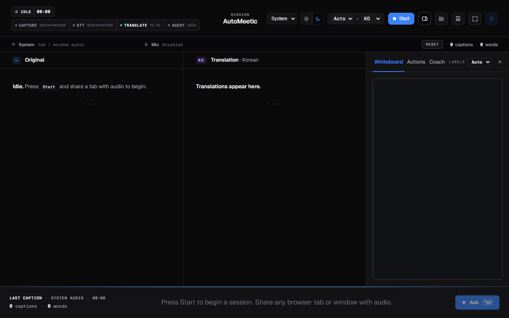
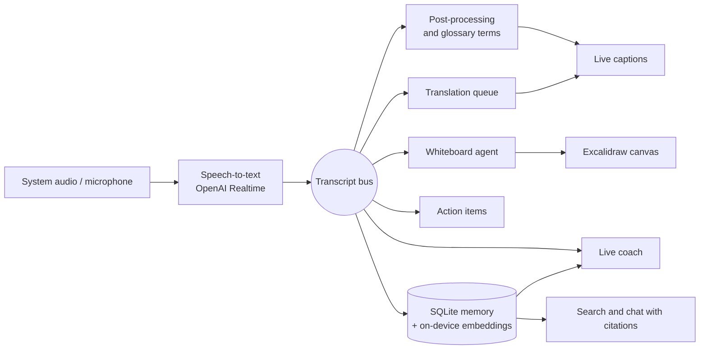

# autoMeetic

A desktop meeting copilot that listens to a call and, while people are still talking, writes live captions,
translates them, draws the discussion as a diagram, collects action items and remembers every meeting so you can ask
about it later.

Electron, React and TypeScript. Speech-to-text and language models run on the OpenAI API; meeting memory and its
embeddings stay on your machine.



_The app before a session starts. The left column fills with the live transcript, the middle with its translation,
and the right shelf switches between the whiteboard, action items and the coach._

## What it does

| During the meeting                                                                                | After the meeting                                                                           |
| ------------------------------------------------------------------------------------------------- | ------------------------------------------------------------------------------------------- |
| **Live captions** from system audio or the microphone, finalized sentence by sentence             | **Memory library**: every meeting, its transcript and a generated summary, stored in SQLite |
| **Live translation** side by side with the original (Korean, English, Japanese, Chinese and more) | **Search across meetings** by meaning, using embeddings computed on the device              |
| **Whiteboard** that an agent draws as key concepts come up: Excalidraw diagrams or a mind map     | **Ask your meetings**: chat answers that cite the transcript segments they came from        |
| **Action items** extracted as they are said                                                       | **Glossary** of your team's terms, with suggestions, applied to transcripts and prompts     |
| **Answer assist** on a hotkey, and a **live coach** that draws on earlier meetings                | **Markdown export**                                                                         |

It also detects when a Slack huddle starts, and the interface is available in English, Korean, Japanese and Chinese.

## How it works



Everything that needs a key, the file system or a native module runs in the Electron main process. The React
renderer reaches it only through a typed preload bridge, so the UI never touches the OpenAI key or the database
directly.

| Path            | What is there                                                                                    |
| --------------- | ------------------------------------------------------------------------------------------------ |
| `src/main/`     | Audio capture, speech-to-text, translation, whiteboard agent, action items, coach, memory, Slack |
| `src/preload/`  | The typed bridge between the main process and the UI                                             |
| `src/renderer/` | React UI: transcript columns, caption overlay, whiteboard, memory library, glossary, coach feed  |
| `src/test/`     | Vitest suites for the main process, IPC contracts and renderer logic                             |
| `server/`       | A local proxy used when the UI runs in a browser during development                              |
| `harness/`      | Python scripts that measure speech-to-text and model latency                                     |
| `docs/`         | A design spec and an implementation plan for each feature                                        |

A few choices worth knowing about:

- **Memory stays local.** Meetings, segments, summaries and glossary live in SQLite (`better-sqlite3`). Embeddings
  are computed on the device with `multilingual-e5-small` through transformers.js, in a worker thread behind a
  queue, so search and chat work across languages without sending transcripts to an embedding API.
- **The whiteboard is throttled on purpose.** A small gatekeeper model decides whether the conversation has moved
  enough to redraw before the drawing model runs, each with its own cooldown.
- **Answers are grounded.** Memory chat retrieves transcript segments first and returns the answer with citation
  markers that the UI links back to the moment in the meeting.
- **On-device speech-to-text is in progress.** The build scripts and package layout for a Moonshine sidecar (macOS
  arm64 and x64) are in the repository; it is not yet wired into the app on this branch.

## Run it

Requires Node 20 or later and an OpenAI API key.

```bash
npm install
echo OPENAI_API_KEY=sk-... > .env

npm run dev:electron   # the desktop app
```

Build an installer for your platform:

```bash
npm run build:win      # NSIS installer for Windows
npm run build:mac      # DMG for macOS
```

Models and timing are configurable through environment variables such as `OPENAI_TRANSCRIPTION_MODEL`,
`TRANSLATION_MODEL` and `OPENAI_SUMMARY_MODEL`; the defaults are in `server/proxy.mjs` and `src/main/`.

## Quality

```bash
npm run typecheck
npm run lint
npm test               # Vitest
npm run ci             # all of the above, then a production build
```

- 384 tests across 63 files cover the main-process services, the IPC contracts and the renderer stores.
- CI runs typecheck, lint, tests and a build on every pull request.
- Each feature starts as a design spec and a phased plan in `docs/superpowers/`, and a phase is only marked complete
  when `npm run verify:phase <n>` passes: it checks that the files the plan names exist, then runs typecheck, lint
  and the tests.

## Status

A personal project in active development. Captions, translation, the whiteboard, action items, answer assist, the
memory library with search and chat, the glossary, Slack huddle detection and the live coach are implemented. There
are no published installers yet; build one with the commands above.

Built by [Taejin Jung](https://github.com/taejin5314).
